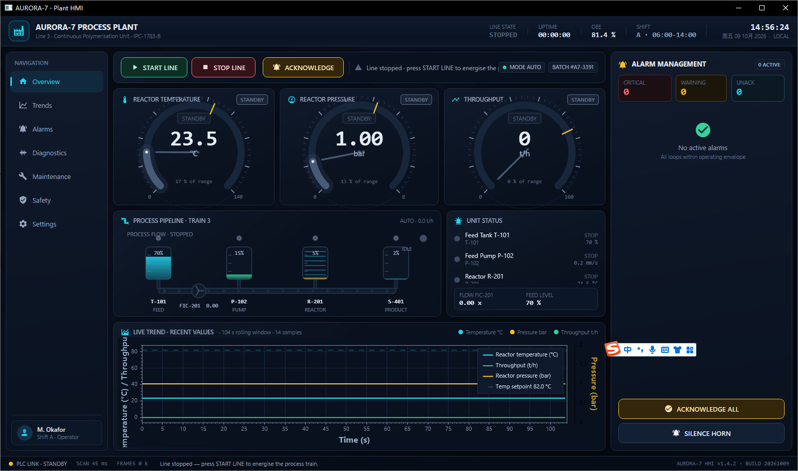

# AURORA-7 · Industrial HMI (WPF / SCADA-lite)

A dark, animated control-room dashboard for a fictional continuous polymerisation line,
built as a single-window WPF application.



## Stack

| Concern | Choice |
| --- | --- |
| UI toolkit | **WPF** (`UseWPF=true`, `net9.0-windows10.0.19041.0`, `EnableWindowsTargeting=true`) |
| UI library | **MaterialDesignThemes 5.3.2 + MaterialDesignColors 5.3.2** (dark `BundledTheme` + `MaterialDesign3.Defaults.xaml`) |
| Chart library | **ScottPlot.WPF 5.1.59** (SkiaSharp) |
| Custom drawing | `FrameworkElement.OnRender` — radial ring gauges and the animated process scheme are drawn with `DrawingContext`/`StreamGeometry` |
| Animation | `CompositionTarget.Rendering` (per-frame) + two `DispatcherTimer`s (200 ms process model, 1 s clock/status) + XAML `Storyboard`/`DoubleAnimation` on buttons and alarm lamps |

## Layout

* **Title bar strip** – plant identity, line state, uptime, OEE, shift, live clock.
* **Left nav rail** – Overview / Trends / Alarms / Diagnostics / Maintenance / Safety / Settings + operator card.
* **Control strip** – START LINE, STOP LINE, ACKNOWLEDGE (with pulsing halo while alarms are unacknowledged), mode/batch chips.
* **Gauges** – reactor temperature, reactor pressure, throughput: animated ring gauges with ticks, setpoint marker, needle, digital readout, state pill and a pulsing alarm halo.
* **Process pipeline** – feed tank → pump (rotating impeller) → reactor → exchanger → silo, with flowing chevrons, live vessel levels, status lamps and a pulsing alarm beacon.
* **Unit status card** – per-unit lamps that pulse via `DataTrigger` storyboards when a unit is in warning/alarm.
* **Live trend** – ScottPlot line chart (temperature + throughput on the left axis, pressure on a secondary right axis) over a rolling ~104 s window.
* **Alarm management panel** – critical/warning/unack counters, severity-coded alarm cards, limit/peak values, ACKNOWLEDGE ALL and SILENCE HORN.
* **Status bar** – PLC link, scan time, frame counter, event ticker, build stamp.

## Build / publish

```bash
dotnet publish PlantHmi.csproj -c Release -r win-x64 --self-contained true \
    -p:PublishSingleFile=true -o dsh-publish-out
```

Output: `dsh-publish-out/PlantHmi.exe` — self-contained, single file, Windows x64 GUI subsystem
(no .NET runtime required on the target machine, Windows 10 2004 or newer).

## Notes

* The window requests the immersive dark title bar through `DwmSetWindowAttribute` (best effort, never fatal).
* If the SkiaSharp native engine cannot start on a host, the trend card degrades to
  "chart engine unavailable" and the rest of the HMI keeps running.
* Unhandled dispatcher exceptions are logged to `%TEMP%\PlantHmi-errors.log` and surfaced in a
  message box instead of terminating the plant screen.
